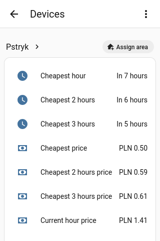

# ha-pstryk-with-plan
Pstryk integration for cost optimizations.
It gives you access to hour/timestamp with best prices and the prices value.
Improvements/bugfixes will came soon as I'm start using this now.

# Sensors

For now only sensor with best price windows are available.



# 📦 Installation

## HACS (Recommended)

[](https://my.home-assistant.io/redirect/hacs_repository/?owner=jmmarek&repository=ha-pstryk-with-plan&category=integration)

> [!NOTE]
> This integration is currently a custom repository. A Pull Request to include it in the HACS default repositories is [already pending](https://github.com/hacs/default/pull/6270).

1. Open HACS in Home Assistant.
2. Click on the three dots in the top right corner and select **Custom repositories**.
3. Add `jmmarek/ha-pstryk-with-plan` with category **Integration**.
4. Search for "Pstryk with plan".
5. Install and restart Home Assistant.

# Tests
Run tests using pytest. You should import home assistant core venv before.
```
source ../core/.venv/bin/activate
pytest
```
